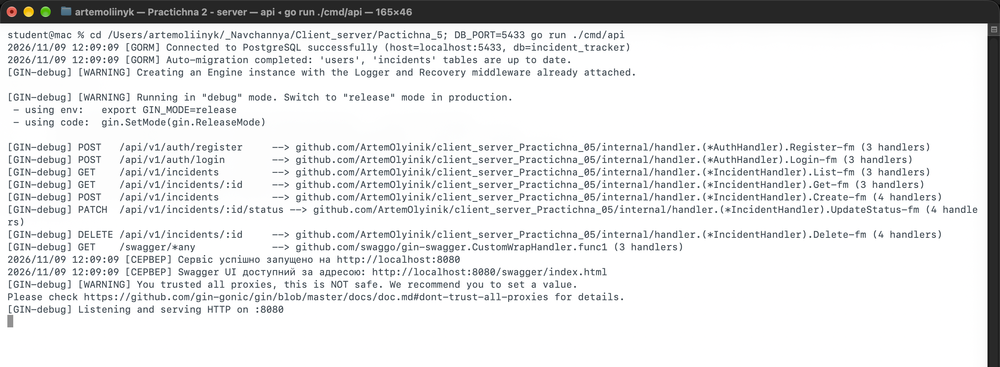
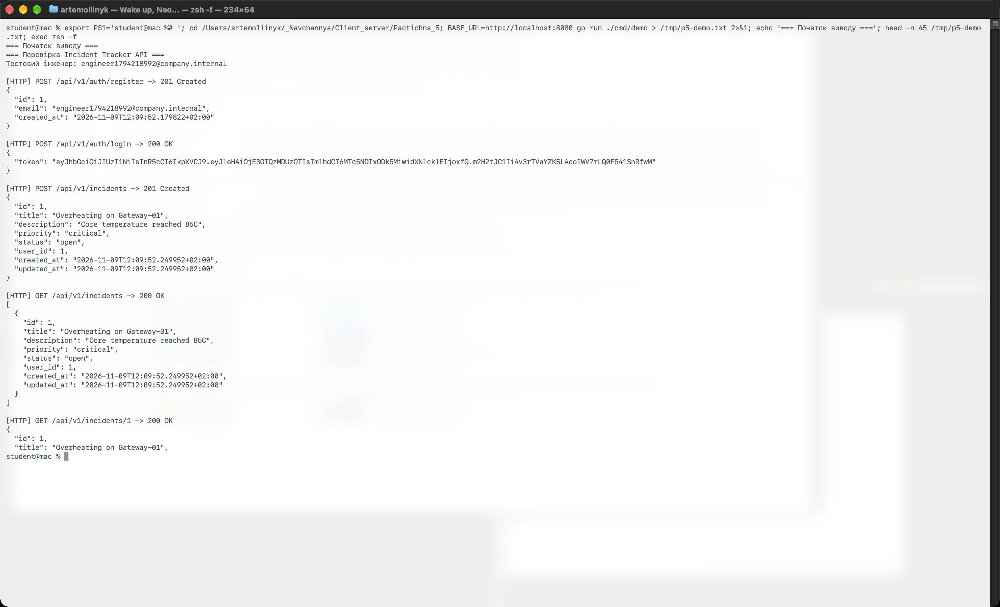
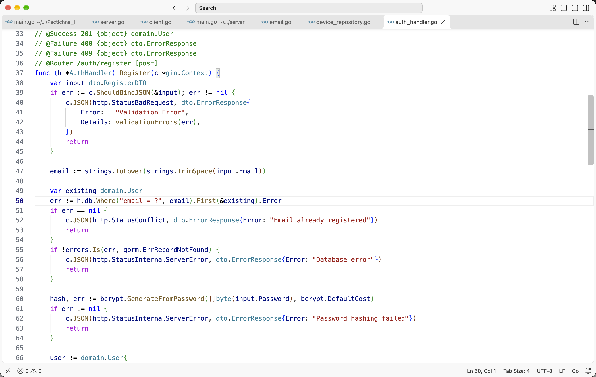
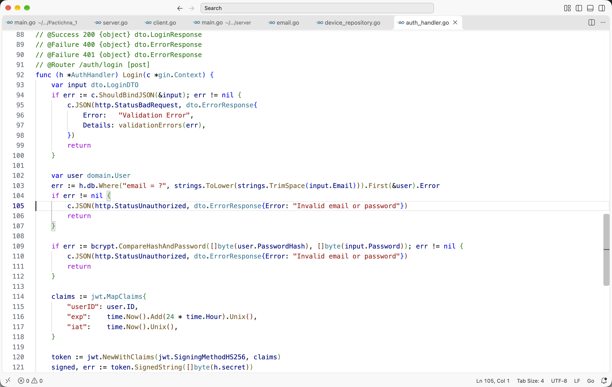
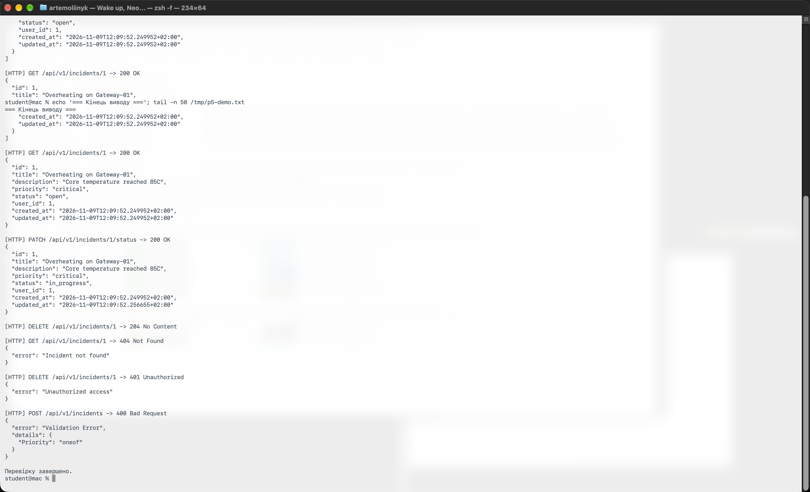
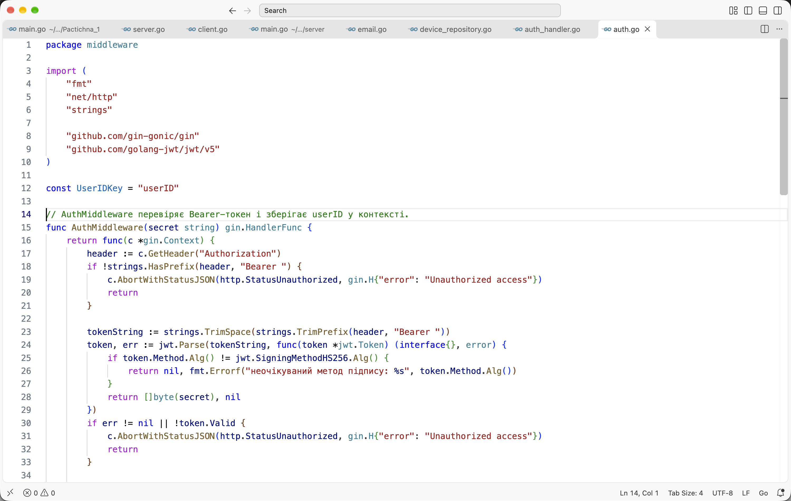
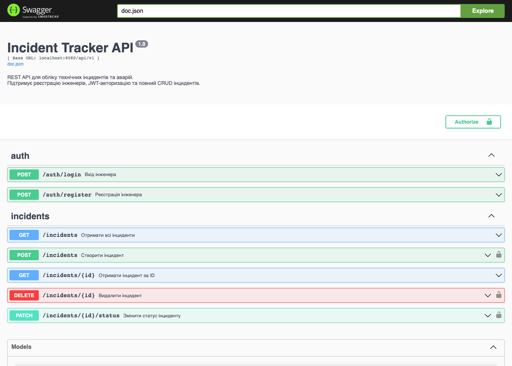
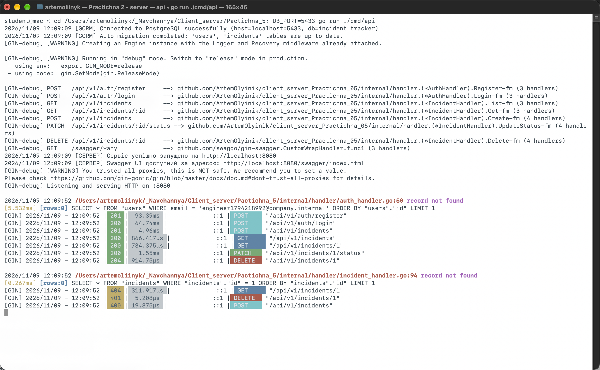
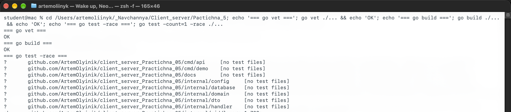

# Практична робота № 5. Розробка REST-сервісу на базі фреймворку Gin та СУБД PostgreSQL

**Виконав:** Олійник Артем Сергійович  
**Курс:** IV  
**Група:** КН-43  
**Дисципліна:** Розробка застосувань клієнт-серверної архітектури  
**Викладач:** Олександр Олександрович Верещагін  
**Рік:** 2026

---

## Мета роботи

- Опанувати розробку вебсервісів на Gin та роботу з `gin.Context`.
- Застосувати декларативну валідацію DTO через теги `binding`.
- Підключити PostgreSQL і виконати міграції через GORM.
- Реалізувати хешування паролів `bcrypt` і видачу JWT-токенів.
- Захистити приватні маршрути JWT Middleware та згенерувати Swagger UI.

---

## Середовище

| Компонент | Версія |
|---|---|
| Операційна система | macOS 27.0.1 |
| Go | 1.27.1 |
| Gin | `github.com/gin-gonic/gin` 1.12.0 |
| GORM | `gorm.io/gorm` 1.31.2 |
| PostgreSQL | 16 (Docker, `postgres:16-alpine`) |
| JWT | `github.com/golang-jwt/jwt/v5` 5.3.1 |
| Swagger | `swag` 1.16.4, `gin-swagger` 1.6.1 |
| Visual Studio Code | 1.145.2 |

Модуль проєкту: `github.com/ArtemOlyinik/client_server_Practichna_05`.

У цьому середовищі порт `5432` уже був зайнятий іншим контейнером, тому PostgreSQL запущено на порту `5433`. У коді типове значення - `5432`, фактичний порт задається змінною `DB_PORT`.

---

## Структура проєкту

```text
client_server_Practichna_05/
├── cmd/api/main.go                  # Gin-сервер і Swagger-анотації
├── cmd/demo/main.go                 # HTTP-клієнт для перевірки
├── docs/                            # згенерована Swagger-документація
├── internal/config/                 # конфігурація з env
├── internal/database/               # GORM, AutoMigrate
├── internal/domain/                 # моделі User та Incident
├── internal/dto/                    # DTO і валідація
├── internal/handler/                # auth та incident обробники
├── internal/middleware/             # JWT Auth Middleware
├── screenshots/                     # скріншоти роботи
├── task/                            # текст завдання
└── README.md
```

---

## Хід виконання

### Рівень 1. Gin-застосунок, PostgreSQL та валідація DTO

#### 1. Ініціалізація та залежності

```bash
go mod init github.com/ArtemOlyinik/client_server_Practichna_05
go get github.com/gin-gonic/gin
go get gorm.io/gorm
go get gorm.io/driver/postgres
```

#### 2. Підключення PostgreSQL

Запускаємо контейнер:

```bash
docker run -d --name postgres-p5 \
    -e POSTGRES_PASSWORD=postgres \
    -e POSTGRES_DB=incident_tracker \
    -p 5433:5432 postgres:16-alpine
```

У `internal/config` зібрано DSN із змінних `DB_HOST`, `DB_PORT`, `DB_USER`, `DB_PASSWORD`, `DB_NAME`. `internal/database.Connect` перевіряє з'єднання через `Ping`, а `Migrate` виконує `AutoMigrate` для `User` та `Incident`.

#### 3. Модель Incident

```go
type Incident struct {
    ID          uint      `gorm:"primaryKey" json:"id"`
    Title       string    `gorm:"size:100;not null" json:"title"`
    Description string    `gorm:"type:text;not null" json:"description"`
    Priority    string    `gorm:"size:20;not null" json:"priority"`
    Status      string    `gorm:"size:20;default:'open'" json:"status"`
    UserID      uint      `gorm:"index" json:"user_id,omitempty"`
    CreatedAt   time.Time `json:"created_at"`
    UpdatedAt   time.Time `json:"updated_at"`
}
```

#### 4. DTO та валідація

```go
type CreateIncidentDTO struct {
    Title       string `json:"title" binding:"required,min=3,max=100"`
    Description string `json:"description" binding:"required"`
    Priority    string `json:"priority" binding:"required,oneof=low medium high critical"`
}
```

`ShouldBindJSON` перевіряє поля до виклику бізнес-логіки. У разі помилки сервер повертає `400 Bad Request` і перелік некоректних полів.

#### 5. Запуск і перевірка

```bash
DB_PORT=5433 go run ./cmd/api
```



*Рис. 1. GORM підключився до PostgreSQL, міграція створила таблиці `users` та `incidents`, Gin зареєстрував маршрути й Swagger UI.*

Демонстраційний клієнт реєструє інженера, входить у систему, створює інцидент, читає список і один запис:

```bash
go run ./cmd/demo
```



*Рис. 2. `POST /auth/register` повернув `201`, `POST /auth/login` - `200` з JWT, `POST /incidents` - `201` з `status=open` і `user_id=1`, `GET /incidents` і `GET /incidents/1` - `200`.*

---

### Рівень 2. Повний життєвий цикл інцидентів та автентифікація користувачів

#### 1. CRUD-операції

Додано `GET /incidents/:id`, `PATCH /incidents/:id/status` і `DELETE /incidents/:id`. Статус змінюється лише на одне з дозволених значень `open`, `in_progress`, `resolved`, `closed`. Після видалення запису повторний `GET` повертає `404`.

#### 2. Модель User і bcrypt

```go
type User struct {
    ID           uint      `gorm:"primaryKey" json:"id"`
    Email        string    `gorm:"uniqueIndex;not null" json:"email"`
    PasswordHash string    `gorm:"not null" json:"-"`
    CreatedAt    time.Time `json:"created_at"`
}
```

Пароль не зберігається у відкритому вигляді. `bcrypt.GenerateFromPassword` створює повільний адаптивний хеш, а `bcrypt.CompareHashAndPassword` перевіряє його під час входу.



*Рис. 3. Фрагмент `auth_handler.go`: валідація DTO, перевірка унікальності email і хешування пароля.*

#### 3. JWT-токен

Після успішного входу сервер формує `MapClaims` з `userID`, `iat` та `exp` на 24 години і підписує токен алгоритмом HS256:

```go
claims := jwt.MapClaims{
    "userID": user.ID,
    "exp":    time.Now().Add(24 * time.Hour).Unix(),
    "iat":    time.Now().Unix(),
}
token := jwt.NewWithClaims(jwt.SigningMethodHS256, claims)
signed, err := token.SignedString([]byte(h.secret))
```



*Рис. 4. Фрагмент `Login`: перевірка пароля, формування Claims і підпис HS256.*

#### 4. Перевірка CRUD



*Рис. 5. `PATCH` змінив статус на `in_progress`, `DELETE` повернув `204`, повторний `GET` - `404`, запит без токена - `401`, невалідний пріоритет - `400` з полем `Priority`.*

---

### Рівень 3. JWT Middleware та Swagger UI

#### 1. Захисний JWT Middleware

`AuthMiddleware` перевіряє заголовок `Authorization`, вимагає префікс `Bearer `, парсить токен і перевіряє підпис HS256. У разі помилки запит переривається через `c.AbortWithStatusJSON(401, ...)`. Після успіху `userID` зберігається в контексті:

```go
c.Set(UserIDKey, uint(userID))
c.Next()
```



*Рис. 6. Фрагмент `middleware/auth.go`: перевірка Bearer-токена, підпису та збереження `userID`.*

#### 2. Захист маршрутів

Публічними залишаються `POST /auth/register`, `POST /auth/login`, `GET /incidents` і `GET /incidents/:id`. Створення, зміна статусу та видалення інциденту захищені:

```go
protected := incidents.Group("")
protected.Use(middleware.AuthMiddleware(cfg.JWTSecret))
{
    protected.POST("", incidentHandler.Create)
    protected.PATCH("/:id/status", incidentHandler.UpdateStatus)
    protected.DELETE("/:id", incidentHandler.Delete)
}
```

Під час створення інциденту `UserID` береться з контексту, тому запис прив'язаний до авторизованого інженера. У відповіді видно `user_id: 1`.

#### 3. Swagger UI

`swag init` згенерував документацію в теці `docs`. У `main` підключено:

```go
router.GET("/swagger/*any", ginSwagger.WrapHandler(swaggerFiles.Handler))
```

Swagger UI доступний за адресою `http://localhost:8080/swagger/index.html`. На сторінці є кнопка `Authorize` для Bearer-токена, групи `auth` та `incidents`, а захищені маршрути позначені замком.



*Рис. 7. Swagger UI: опис API, Authorize, публічні маршрути та захищені операції з інцидентами.*

#### 4. Журнал запитів

Gin Logger виводить метод, шлях, статус і тривалість. GORM показує SQL-запити до `users` та `incidents`.



*Рис. 8. Консоль сервера: підключення до PostgreSQL, маршрути, SQL-запити та статуси `201`, `200`, `204`, `404`, `401`, `400`.*

#### 5. Тести та збірка

```bash
go vet ./...
go build ./...
go test -count=1 -race ./...
```



*Рис. 9. `go vet` і `go build` без помилок, тести JWT Middleware пройшли з детектором гонок за 1.709 с.*

---

## Таблиця ендпоінтів

| Метод | Шлях | Доступ | Призначення |
|---|---|---|---|
| `POST` | `/api/v1/auth/register` | публічний | реєстрація інженера |
| `POST` | `/api/v1/auth/login` | публічний | вхід і видача JWT |
| `GET` | `/api/v1/incidents` | публічний | список інцидентів |
| `GET` | `/api/v1/incidents/:id` | публічний | один інцидент |
| `POST` | `/api/v1/incidents` | Bearer JWT | створення інциденту |
| `PATCH` | `/api/v1/incidents/:id/status` | Bearer JWT | зміна статусу |
| `DELETE` | `/api/v1/incidents/:id` | Bearer JWT | видалення |

---

## Інструкція запуску

```bash
# 1. Перейти в директорію проєкту
cd client_server_Practichna_05

# 2. Запустити PostgreSQL
docker run -d --name postgres-p5 \
    -e POSTGRES_PASSWORD=postgres \
    -e POSTGRES_DB=incident_tracker \
    -p 5433:5432 postgres:16-alpine

# 3. Завантажити залежності
go mod download

# 4. Запустити API
DB_PORT=5433 go run ./cmd/api

# 5. В іншому терміналі виконати демонстраційний клієнт
go run ./cmd/demo

# 6. Відкрити Swagger UI
open http://localhost:8080/swagger/index.html
```

Якщо порт `5432` вільний, достатньо запустити контейнер на `-p 5432:5432` і не задавати `DB_PORT`. Секрет JWT задається змінною `JWT_SECRET`; типове значення призначене лише для локальної перевірки.

---

## Висновки

У роботі створено Gin-сервіс обліку інцидентів із підключенням до PostgreSQL через GORM. DTO валідуються декларативно, паролі зберігаються у вигляді bcrypt-хешу, а після входу клієнт отримує підписаний JWT. JWT Middleware захищає створення, зміну статусу та видалення, а `userID` з токена прив'язує інцидент до конкретного інженера.

Перевірено повний життєвий цикл: реєстрація, вхід, створення, читання, зміна статусу, видалення та повторне читання з `404`. Окремо перевірено відмову без токена (`401`) і невалідний пріоритет (`400`). Swagger UI показує всі маршрути та дозволяє авторизуватися через Bearer-токен. Тести й статичний аналіз проходять без помилок.

---

## Контрольні питання

1. **Чим Gin відрізняється від Chi?**  
   Gin - повноцінний фреймворк із власним контекстом, валідацією, JSON-рендерингом і вбудованими Logger/Recovery. Chi - легкий маршрутизатор, сумісний зі стандартним `http.Handler`, без власного контексту й валідатора. Gin зручніший для швидкої розробки API, Chi - для мінімалістичної архітектури.

2. **Як `gin.Context` зменшує навантаження на GC?**  
   Контексти беруться з `sync.Pool` і повертаються після завершення запиту. Це зменшує кількість нових виділень пам'яті та навантаження на збирач сміття.

3. **Чим `ShouldBindJSON` відрізняється від `BindJSON`?**  
   `ShouldBindJSON` повертає помилку, і обробник сам вирішує, який статус і формат відповіді використати. `BindJSON` автоматично перериває запит із `400`, що не завжди зручно для кастомного формату помилок.

4. **Які переваги GORM над `database/sql`?**  
   GORM бере на себе побудову параметризованих запитів, міграції, зв'язки, транзакції та мапінг рядків у структури. Це швидше для CRUD, але для складних запитів іноді потрібен прямий SQL.

5. **Чому bcrypt, а не MD5 або SHA-256?**  
   MD5 і SHA-256 швидкі, тому їх легко перебирати. bcrypt навмисно повільний, має сіль і параметр вартості, що ускладнює атаки за словником і на GPU.

6. **З яких частин складається JWT і як сервер перевіряє підпис?**  
   JWT має Header, Payload і Signature. Сервер бере Header і Payload, обчислює HMAC-SHA256 із секретним ключем і порівнює з Signature. Якщо підпис збігається, токен вважається цілісним; додатково перевіряється `exp`.

7. **Як `AbortWithStatusJSON` перериває ланцюжок?**  
   Метод встановлює статус і JSON-тіло, викликає `Abort`, після чого Gin не передає керування наступним обробникам. Поточний middleware завершується, а запит отримує `401`.

8. **Як `swag` генерує документацію?**  
   `swag` читає спеціальні коментарі над `main` та обробниками (`@Summary`, `@Param`, `@Success`, `@Router`), будує OpenAPI-специфікацію і генерує пакет `docs`. Gin-swagger віддає цю специфікацію через Swagger UI.
